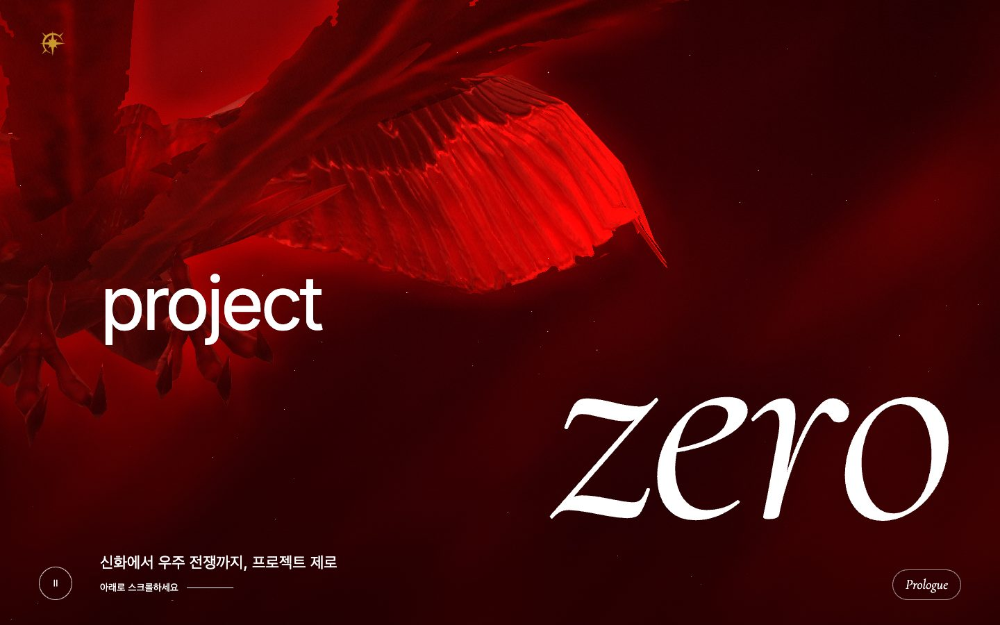
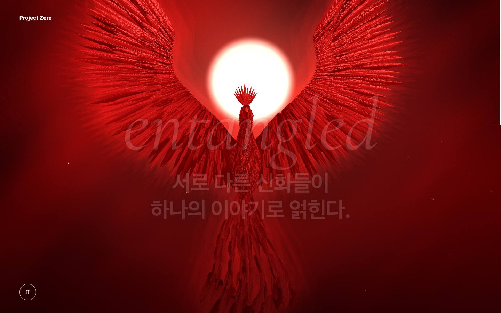
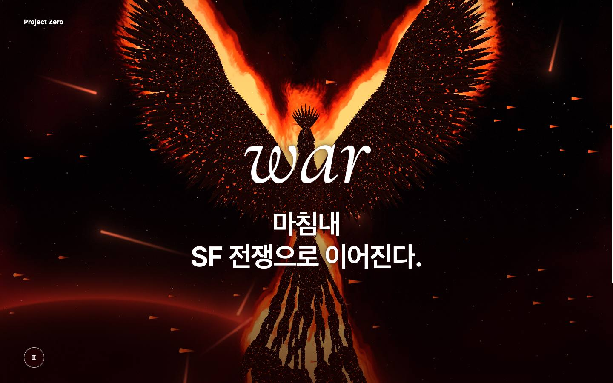
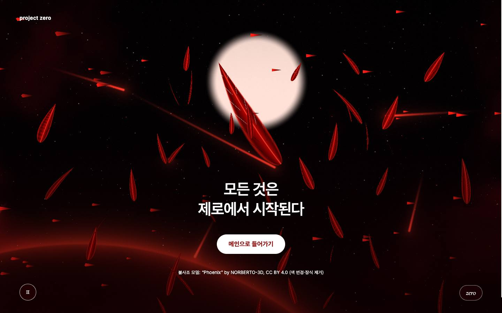
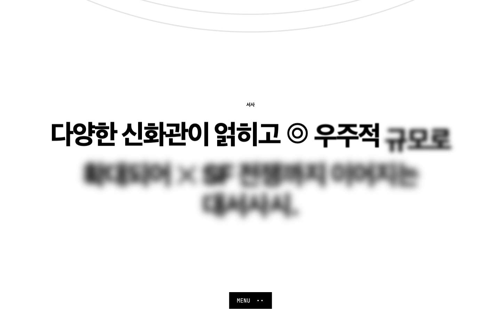
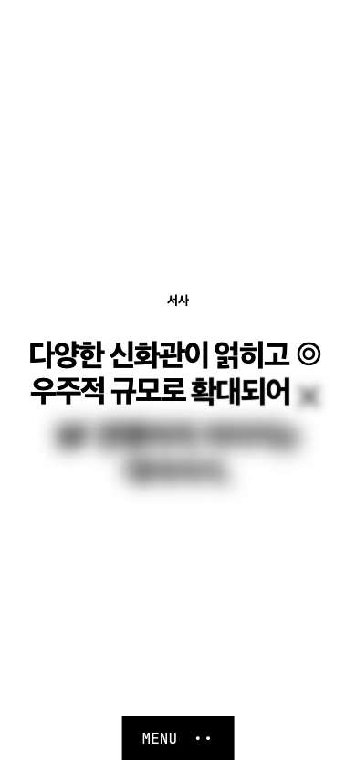
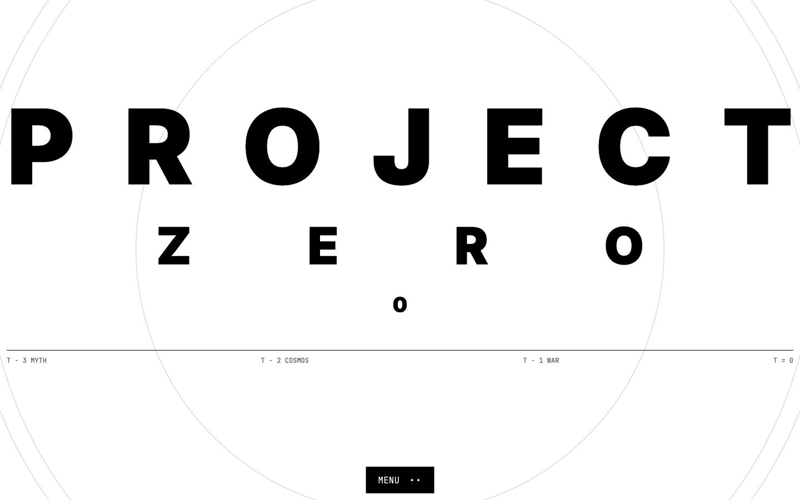
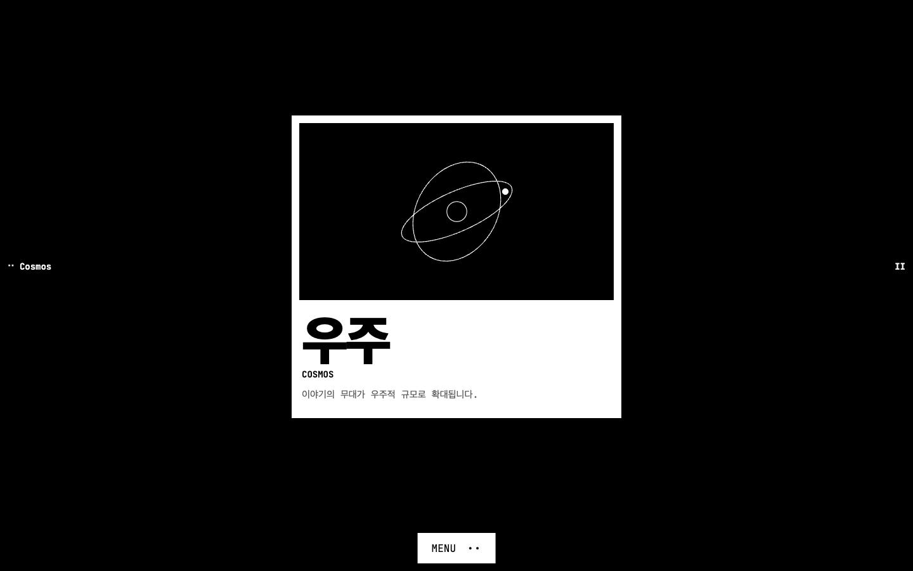

# project zero

[](https://github.com/ryushin01/Genesis/actions/workflows/ci.yml)


다양한 신화관이 얽히고 우주적 규모로 확대되어 SF 전쟁까지 이어지는 대서사시, 소설 **프로젝트 제로**의 홍보 홈페이지입니다.

**[사이트 바로 보기](https://zero.ryushin0.co.kr/)** · **[디자인 시스템(Storybook)](https://zero.ryushin0.co.kr/storybook/index.html)**

> **프로젝트 상태:** 개발 중입니다. 작품의 세계관·인물 자료가 정리되기 전이라 해당 구역은 "기록 준비 중"으로 표시하고, 인트로 문구는 작품 요약에서 뽑은 초안입니다.

## 화면

| 인트로: 첫 화면 | 인트로: 신화 |
|---|---|
|  |  |

| 인트로: 전쟁 | 인트로: 마지막 |
|---|---|
|  |  |

| 메인: 서사 (스크롤) | 모바일 서사 |
|---|---|
|  |  |

| 메인 | 세 개의 흐름 |
|---|---|
|  |  |

## 주요 기능

| 화면 | 내용 |
|---|---|
| 인트로 `/` | 스크롤에 따라 태양을 향해 날아가는 불사조 → 우주 → 전쟁 → 태양에 닿아 초신성처럼 터지고, 빛나는 깃털 하나가 화면 가운데로 내려와 로고로 바뀌는 적색 WebGL 장면. 로딩 화면, 현재 장 이름 칩, 따라오는 커서 원. 맨 아래에서 메인으로 이동 |
| 메인 `/main` | 흑백 편집 디자인의 작품 소개: 서사, 세 개의 흐름, 기록 보관소, 전체 화면 메뉴. 스크롤하면 제목이 벌어지며 멀어지고, 고정된 서사 문장이 단어마다 또렷해지며, 흐름 카드가 떠오르며 선화가 그려짐(CSS 스크롤 타임라인) |
| 접근성 | 동작 줄이기 대응, 배경 애니메이션 정지, 키보드 조작, 본문 바로가기, 저사양 기기 해상도 자동 조절 |

불사조는 [“Phoenix”](https://sketchfab.com/3d-models/phoenix-243fea4f846f44d18d37bf371272b7ec) by [NORBERTO-3D](https://sketchfab.com/norberto3d)([CC BY 4.0](http://creativecommons.org/licenses/by/4.0/))를 실시간 3D로 그립니다. 색을 #8B0000으로 바꾸고 목의 장식을 뺐습니다. 마지막 장면의 깃털은 [“Feathers”](https://sketchfab.com/3d-models/feathers-c987c56694a44559b75ed66429b04ee4) by [victorberdugo1](https://sketchfab.com/victorberdugo1), 로고는 [“Phoenix Logo”](https://sketchfab.com/3d-models/phoenix-logo-8dc1ba8095f1447fac7092d0299add27) by [Suraj-456tyu](https://sketchfab.com/Suraj-456tyu)(모두 CC BY 4.0, 색 변경)입니다. 불길과 빛, 배경은 셰이더로 그립니다.

## 기술 스택


| 구분 | 사용 기술 |
|---|---|
| 프레임워크 | Next.js 16 (App Router), React 19, TypeScript 6 |
| 그래픽 | three.js, GLSL 셰이더 |
| 스타일 | CSS Modules, CSS 스크롤 기반 애니메이션 |
| 아키텍처 | Feature-Sliced Design, Steiger |
| 품질 | Vitest, Testing Library, Storybook, Playwright, axe, eslint-plugin-jsx-a11y, size-limit, Lighthouse CI |
| 모니터링 | Sentry(DSN이 있을 때만), web-vitals |

## 시작하기

```bash
pnpm install
pnpm dev
```

| 명령 | 설명 |
|---|---|
| `pnpm dev` | 개발 서버 실행 |
| `pnpm build` | 프로덕션 빌드 |
| `pnpm lint` · `pnpm lint:fsd` | ESLint · FSD 구조 검사 |
| `pnpm typecheck` | 타입 검사 |
| `pnpm test` | 단위·컴포넌트 테스트 |
| `pnpm e2e` | 프로덕션 빌드 E2E 테스트 |
| `pnpm size` · `pnpm lhci` | 번들 크기 예산 · Lighthouse 점수 기준 검사 (먼저 빌드 필요) |
| `pnpm storybook` | Storybook 실행 |

## 프로젝트 구조

```text
src/
├── app/            # Next 라우트 (재내보내기만)
├── _app/           # 루트 레이아웃, 전역 스타일
├── _pages/
│   ├── intro/      # WebGL 인트로 (model: 문구·타임라인, lib: 장면·셰이더)
│   └── main/       # 흑백 메인 페이지
└── shared/lib/     # 공통 훅
public/models/      # 불사조·깃털·로고 3D 모델(glTF)과 라이선스
```

## 문서

| 문서 | 내용 |
|---|---|
| [개발 가이드](docs/development.md) | 문구 교체, 인트로 장면 조정, 디자인 기준 |
| [CHANGELOG](CHANGELOG.md) | 버전 기록 |

## 출처

| 자료 | 저작자 | 사용 허락 | 원본 |
|---|---|---|---|
| “Phoenix” 3D 모델 (불사조, 색 변경·목 장식 제거) | NORBERTO-3D | CC BY 4.0 | [Sketchfab](https://sketchfab.com/3d-models/phoenix-243fea4f846f44d18d37bf371272b7ec) |
| “Feathers” 3D 모델 (마지막 장면의 깃털, 색 변경) | victorberdugo1 | CC BY 4.0 | [Sketchfab](https://sketchfab.com/3d-models/feathers-c987c56694a44559b75ed66429b04ee4) |
| “Phoenix Logo” 3D 모델 (로고, 색 변경) | Suraj-456tyu | CC BY 4.0 | [Sketchfab](https://sketchfab.com/3d-models/phoenix-logo-8dc1ba8095f1447fac7092d0299add27) |
| Cormorant 글꼴 | The Cormorant Project Authors | SIL OFL 1.1 | [CatharsisFonts/Cormorant](https://github.com/CatharsisFonts/Cormorant) |
| Inter 글꼴 | The Inter Project Authors | SIL OFL 1.1 | [rsms/inter](https://github.com/rsms/inter) |
| JetBrains Mono 글꼴 | The JetBrains Mono Project Authors | SIL OFL 1.1 | [JetBrains/JetBrainsMono](https://github.com/JetBrains/JetBrainsMono) |

모델별 라이선스 원문은 `public/models/*-license.txt`에 함께 있습니다. 불길·빛·배경은 셰이더로 직접 그렸고, 사이트의 '3D 모델·글꼴 출처' 링크가 이 표로 옵니다.
